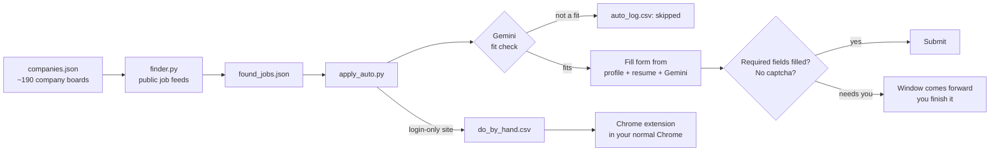

# Job-Maxer

**Find entry-level jobs, check each one fits you, and fill (or submit) the application, from your own laptop.**

Job-Maxer is a personal job-application assistant for freshers and interns. It reads the public job feeds of
~190 companies, uses Google Gemini to decide which openings actually suit you, fills the application form from
your profile and resume, and submits it when it is safe to do so. Anything it can't finish on its own
(captchas, email codes, login-only portals) goes to a short "do by hand" list, and a Chrome extension
fills those forms in your normal, logged-in browser while you click Submit.

Everything runs locally. Your profile, documents and API key never leave your machine except to fill the
form you are applying to and the Gemini calls you configure.

---

## Features

| | |
|---|---|
| **Job finder** | Pulls open roles from Greenhouse, Lever, Ashby, Workable and Workday public feeds; keeps engineering roles in your locations and drops senior titles. Flags jobs that are new since the last run. |
| **AI fit check** | One Gemini call per job reads the full description and skips roles that need experience, are in the wrong field, or are in the wrong location, and gives a one-line reason. |
| **Auto-apply** | Fills Greenhouse and Ashby forms (text, dropdowns, react-select, Yes/No buttons, date pickers, file uploads) and submits only when every required field is filled. Daily limit, test mode, full log. |
| **Written answers** | "Why do you want to work here?" style questions are answered by Gemini in your voice, using only facts from your profile and resume. Every answer is saved to `ai_answers.jsonl` for you to review. |
| **Human hand-off** | Captcha, emailed verification code or a missing required field: the bot brings the window to the front, beeps, and waits for you, then carries on. |
| **Chrome extension** | "Fill with Job Bot" button for any application form in your own Chrome (Workday, Lever, Workable, Wellfound, LinkedIn Easy Apply, Naukri...). You always click Submit. |
| **Assist mode** | `autofill.py` opens any URL, fills what it recognises, colours the fields, and learns new answers you type. |
| **Government watcher** | Checks recruitment pages (PSUs, research labs, etc.) for new notices and pops up an alert. |
| **Daily schedule** | One click sets up a Windows task: find → apply → check notices, every morning. |

---

## How it works



| Site | What the bot does |
|---|---|
| Greenhouse, Ashby | Fills and submits on its own |
| Workday | Fit check only, then adds the job to your do-by-hand list (Workday needs an account per company) |
| Lever, Workable | Do-by-hand list (they block automated browsers) |
| LinkedIn, Naukri, Wellfound, Internshala, Indeed | Never automated. Use the extension and click Submit yourself |

---

## Safety rules built in

- It never types into password, OTP or captcha fields, and never signs NDAs, e-signatures or "I personally completed this" statements.
- It only says "Yes" to standard privacy and accuracy confirmations. Anything about availability, relocation, visas, salary, background checks and so on comes from your profile or is left for you.
- Gemini is told to answer **only from your facts** and to reply `UNKNOWN` (the field is left empty) rather than guess.
- Aadhaar, PAN, voter ID and passport numbers and scans are **only** used on government sites. Photos and signatures are never attached on company sites.
- `test_mode` is **on** by default: forms are filled but nothing is submitted until you turn it off.
- A daily limit (`max_per_day`) and a log of every job and every answer.

---

## Setup (Windows)

**You need:** Python 3.10+, Google Chrome and a free [Gemini API key](https://aistudio.google.com/apikey).

```bash
git clone https://github.com/Yagneshbalineni77/Job-Maxer.git
cd Job-Maxer
pip install -r requirements.txt
```

The bot drives your installed Chrome, so there's no need for `playwright install`.

**1. Your profile:** copy the example and fill in your details.

```bash
copy profile.example.json profile.json
```

Fill every `""` you can. The `alternatives` lists help the bot pick the right dropdown option (for example "B.Tech" vs "Bachelor's Degree").
`employment_note` and `offer_status` are free text that Gemini reads when it answers questions.

**2. Your documents:** put `resume.pdf` (and optionally `cover_letter.pdf`) in `docs/`. See [docs/README.md](docs/README.md).
You can add an optional `docs/pitch.txt` with a few lines about yourself; it gives Gemini more to work with.

**3. Your Gemini key:** create `gemini_key.txt` in the project folder with the key on the first line.
You can put several keys on separate lines, and the bot moves to the next one when a key's daily free quota runs out.
Setting the `GEMINI_API_KEY` environment variable also works.

**4. Your preferences:** edit `settings.json` (see below).

**5. Run it:** double-click `start.bat`.

---

## Usage

`start.bat` gives a menu:

```
1. Auto-apply to company jobs (uses settings.json)
2. Auto-apply TEST run (fills forms, submits nothing)
3. Find new company jobs
4. Assist mode: Naukri / LinkedIn / Wellfound, or any one job yourself
5. Open the auto-apply log
6. Open my do-by-hand list
7. Check government sites for new notices
9. Start the Chrome extension helper
```

A typical day: **3** (find jobs) → **2** (test run, check the log) → **1** (real run) → finish the do-by-hand list with the extension.

Or from the command line:

```bash
python finder.py                      # find jobs  ->  found_jobs.csv / found_jobs.json
python finder.py --check              # check which company names in companies.json still work
python apply_auto.py --test           # fill forms, submit nothing
python apply_auto.py                  # real run (when test_mode is false)
python apply_auto.py --limit 3        # at most 3 jobs this run
python apply_auto.py --only <part-of-job-url> --real   # one specific job, for real
python autofill.py <url>              # assist mode on any page
python gov_watch.py                   # new government notices
```

Every run writes `auto_log.csv` (each job with its status: `submitted`, `skipped` + reason, `needs_you`, `manual`),
`ai_answers.jsonl` (every answer Gemini wrote) and `do_by_hand.csv`.

To run it automatically every morning at 9:00, run `setup_daily_alerts.bat` once.

---

## Chrome extension

For login-only portals, use your own Chrome where you are already signed in:

```bash
python build_extension.py     # creates the extension + its private key
```

1. Open `chrome://extensions`, turn on **Developer mode**, click **Load unpacked** and pick the `extension` folder.
2. Start the helper: `start.bat` → **9** (keep that window open).
3. On any application form, click **Fill with Job Bot** (bottom right) or the **J** toolbar icon.
   The panel shows what was filled, what needs you, and what Gemini wrote.
4. Check the form, click the site's own Submit, then click **I submitted** so the auto-apply bot skips that job.

The helper listens only on `127.0.0.1` and only answers requests that carry the extension's private key.
Full steps: [extension/HOW_TO_INSTALL.txt](extension/HOW_TO_INSTALL.txt).

---

## Configuration: `settings.json`

| Key | What it does |
|---|---|
| `max_per_day` | Applications per day (the day starts at `day_starts_at`, 8 am by default) |
| `test_mode` | `true` = fill but never submit |
| `include_roles` / `exclude_roles` | Regex on job titles, applied before any Gemini call |
| `fit_roles` / `fit_avoid` | Plain-English description of the jobs you want and don't want (used by the Gemini fit check) |
| `fit_location` | Country or region you can work in, for the fit check |
| `locations` | Regex on job locations, used by the finder |
| `gemini_models` | Models to try in order; the bot moves on when one runs out of free quota |
| `manual_sites` / `manual_companies` | Never auto-submit here; add to the do-by-hand list instead |
| `skip_companies` | Never apply |
| `captcha_wait_minutes`, `hand_over_minutes` | How long to wait for you when it needs help |

**Add companies:** put the board name in `companies.json` under its platform. That's the part after the
domain in the careers URL, e.g. `job-boards.greenhouse.io/`**`stripe`**. For Workday, use `tenant.wdN|site` from the careers URL
(`https://`**`nvidia.wd5`**`.myworkdayjobs.com/`**`NVIDIAExternalCareerSite`** → `nvidia.wd5|NVIDIAExternalCareerSite`).
Run `python finder.py --check` to confirm they work.

**Government sites:** add careers page URLs to `gov_sites.json`, and add the jobs you want to fill in assist mode to `jobs.json`
(`[{"name": "...", "closes": "...", "url": "...", "check": "..."}]`).

---

## Project layout

```
finder.py                      job finder (Greenhouse / Lever / Ashby / Workable / Workday feeds)
apply_auto.py                  autonomous apply loop, logging, hand-off to you
autofill.py                    form reading and filling engine + assist mode
ai.py                          Gemini client: fit check + question answering, key/model rotation
server.py                      local helper for the Chrome extension (127.0.0.1:8765)
build_extension.py             generates the extension from extension_content_template.js
gov_watch.py                   government recruitment notice watcher
companies.json                 company job boards to search
gov_sites.json                 government careers pages to watch
settings.json                  your preferences
profile.example.json           template for profile.json
docs/                          your resume and documents (git-ignored)
start.bat                      menu
setup_daily_alerts.bat         daily Windows scheduled task
```

## Privacy

`.gitignore` keeps `profile.json`, `answers.json`, `gemini_key.txt`, `docs/`, the bot's Chrome profiles,
the generated extension (with its key), logs and job lists out of git. Check `git status` before you push a fork.

## Limitations

- Windows-first (`start.bat`, popups and beeps use Windows APIs). The Python core runs elsewhere with small changes.
- ATS forms change often. If a field is missed, run assist mode on that page, fill it yourself, and press `l` so the bot learns it.
- Gemini's free tier allows a limited number of requests per day per model. The bot batches one call per job and moves between models and keys.

## Responsible use

Use this to apply **only to jobs you really want and qualify for**, with truthful information. Respect each site's terms:
the bot deliberately does not automate LinkedIn, Naukri and similar platforms, and it always leaves captchas and
verification codes to you. You are responsible for every application sent in your name, so review the logs.

## License

[Apache License 2.0](LICENSE)
